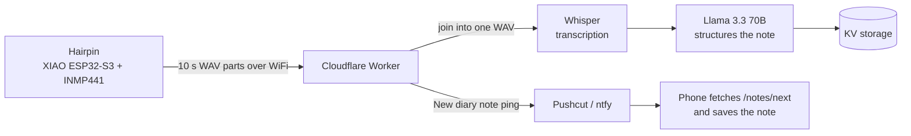

# Hairpin Voice Diary

A voice recorder small enough to hide in a hairpin. Press a button, talk, press it again, and a few seconds later a formatted diary note lands on your phone.

It runs entirely on free plans: a Seeed XIAO ESP32-S3 records the audio, a Cloudflare Worker transcribes and formats it with Workers AI, and your phone picks up the finished note.



## What it does

- Records the moment you press the button, even from deep sleep, up to 225 seconds per recording.
- Keeps audio in PSRAM while recording (16 kHz, 16-bit mono WAV), so nothing touches flash and the audio stays crackle-free.
- Uploads in 10-second parts with retries, over your phone's hotspot or home WiFi.
- Saves recordings on the board when there's no WiFi and sends them later.
- Joins all the parts into **one** WAV before transcribing, so words never come back in the wrong order.
- Turns the transcript into a note with topic headings, to-dos, key phrases, a summary and your original words.
- Delivers notes to your phone in order, one at a time, never writes an empty note and skips duplicates.
- Serves a small local web page for downloading or deleting recordings stored on the board.

Here's a real note, as it arrives in the iPhone Notes app:

> ☁️ **Today's Diary** ☁️<br>
> Tuesday, November 24, 2026
>
> 💇 **Hairpin test**
>
> This is a test to see if the hairpin works.
>
> 🔑 **Key Phrases:** hairpin works, this is a test<br>
> 📝 **Summary:** This is a test to see if the hairpin works.
>
> 🎙️ **Original**<br>
> This is a test to see if the hairpin works.

The topic headings, to-dos, key phrases and summary are written by the AI; the Original section is exactly what was transcribed.

## Repository layout

```
firmware/
  hairpin_recorder/
    hairpin.ino   the recorder
    partitions.csv         gives saved recordings ~5.5 MB instead of 1.5 MB
  tests/
    mic_test.ino           prints the microphone level
    wifi_scan.ino          lists the WiFi names the board can see
    button_test.ino        shows whether the D0 button reads pressed
worker/
  worker.js                the Cloudflare Worker
docs/
  hairpin_workshop.pdf     the full step-by-step workshop guide
```

## Hardware

| Part                               | Notes                                                        |
| ---------------------------------- | ------------------------------------------------------------ |
| Seeed Studio XIAO ESP32-S3 (plain) | 8 MB PSRAM, 8 MB flash. Connect the included WiFi antenna.   |
| INMP441 I2S microphone             |                                                              |
| 3.7 V LiPo, 200 to 400 mAh         | To the BAT+ / BAT- pads under the board. Charges over USB-C. |

### Wiring

| INMP441 | XIAO ESP32-S3                            |
| ------- | ---------------------------------------- |
| VDD     | 3V3                                      |
| GND     | GND                                      |
| L/R     | GND (required: selects the left channel) |
| SD      | D3 (GPIO4)                               |
| SCK     | D4 (GPIO5)                               |
| WS      | D5 (GPIO6)                               |

**Button:** one side to 3.3 V, the other to **D0 (GPIO1)**, with a 10 kΩ resistor from D0 to GND. It also wakes the board from deep sleep.

The schematic also has a CH376S storage module on D7 to D10. The firmware doesn't use it (see Future improvements).

## Quick start

The [workshop guide](docs/hairpin_workshop.pdf) walks through every click. In short:

### 1. Firmware

1. Install Arduino IDE 2 and the **esp32 by Espressif Systems** board package (3.x).
2. Tools: Board **XIAO_ESP32S3**, PSRAM **OPI PSRAM**, USB CDC On Boot **Enabled**.
3. Open `firmware/hairpin_recorder/hairpin_recorder.ino` (keep `partitions.csv` next to it).
4. Fill in the settings at the top and upload.

| Setting              | Meaning                                                                        |
| -------------------- | ------------------------------------------------------------------------------ |
| `GAIN_SHIFT`         | Volume. Lower = louder, one step doubles it. 15 suits hair-to-mouth distance.  |
| `WIFI_LIST`          | Networks to try, in order. 2.4 GHz only; names must match exactly.             |
| `UPLOAD_URL`         | `https://voice-diary.<subdomain>.workers.dev/upload`                           |
| `DEVICE_KEY`         | Shared secret, identical to the Worker's. Letters and numbers, 20+ characters. |
| `MAX_SECONDS`        | Longest recording (225).                                                       |
| `PART_SECONDS`       | Upload part length (10).                                                       |
| `IDLE_SLEEP_SECONDS` | Sleep after this long idle (180).                                              |
| `TIMEZONE`           | POSIX TZ string used to name recordings (UK by default).                       |

### 2. Worker

1. Cloudflare dashboard: create a Worker named `voice-diary` and paste `worker/worker.js`.
2. Create a KV namespace and bind it as `NOTES`.
3. Add a Workers AI binding named `AI`.
4. Add the secret `DEVICE_KEY`.
5. Add a cron trigger `0 * * * *` (hourly safety net).
6. Phone delivery: add the secret `PUSHCUT_URL` (iPhone) or `NTFY_URL` (Android).
7. Open `/setup`, paste the key, click **Check status**.

### 3. Phone

**iPhone:** a four-action Shortcut named _Voice Diary_: Get Contents of URL (`/notes/next`, header `X-Device-Key`), Text, If Text **contains ☁️**, Create Note in _My Voice Diary_. A free Pushcut notification opens `shortcuts://run-shortcut?name=Voice%20Diary` when tapped.

**Android (designed, not yet tested):** ntfy receives the ping; a MacroDroid macro fetches `/notes/next`, and if the text contains ☁️ writes it to a new file in _Documents/My Voice Diary_. Read the notes in Markor or Obsidian.

## Using it

| Button             | Action                                                |
| ------------------ | ----------------------------------------------------- |
| Press the button   | Start recording (wakes from sleep)                    |
| Press it again     | Stop, upload or save offline, sleep                   |
| Plug in or press R | Wake, send saved recordings, serve the local web page |

Recordings saved offline are sent with the next recording, or when the board is plugged in or reset near WiFi.

| LED              | Meaning         |
| ---------------- | --------------- |
| Steady on        | Recording       |
| On while sending | Uploading       |
| 3 quick flashes  | Done            |
| 2 slow flashes   | Saved for later |
| Fast flashing    | Error           |
| Blip every 3 s   | Awake and idle  |

## Worker API

All routes except `GET /setup` need the header `X-Device-Key`. Errors always come back as JSON.

| Route                   | Purpose                                                                                                         |
| ----------------------- | --------------------------------------------------------------------------------------------------------------- |
| `POST /upload`          | Raw WAV body, `X-Filename: YYMMDD-HHMMSS_pNNofMM.wav`. Stores the part; when all parts are in, builds the note. |
| `GET /notes/next`       | One finished note as plain text, oldest undelivered first, or an empty body. Never lists KV.                    |
| `GET /notes`            | Latest notes as JSON, for debugging. `?consume=1` marks them all delivered.                                     |
| `GET /setup`            | Small dashboard page.                                                                                           |
| `GET /setup/status`     | Counts of notes and waiting audio parts.                                                                        |
| `POST /setup/reprocess` | Finishes any recording that's been quiet for 3 minutes.                                                         |

Notes are stored as a linked list (`note:<iso>::<session>`, each pointing at the previous one) with a single pointer key `ptr:notes`, so the phone's path uses only direct reads.

## Running costs

Free at diary scale. Workers AI's free 10,000 neurons a day covers roughly 200 minutes of transcription. KV's free tier allows 1,000 writes a day (about 40 four-minute recordings) and 1,000 lists (the hourly check uses about 24).

## Limitations

**Hardware**

- The button picks up some interference, so it's kept to press to record and press to stop. Long press and double press weren't reliable enough.
- Recordings stop at 225 seconds, the most the 8 MB PSRAM can hold.
- Offline storage holds about 2.5 minutes of audio; when it's full, extra parts are lost.
- No battery meter.

**WiFi and phone**

- 2.4 GHz only, and network names must match exactly, hidden spaces included.
- An iPhone hides its hotspot unless the Personal Hotspot screen is open.
- Saved recordings aren't retried automatically while the board sleeps; they go out with the next recording or a reset.
- iPhone delivery needs one tap per note; zero-tap needs Pushcut Pro and a spare device.
- The Android route is untested and saves text files rather than notes in a notes app.
- The local web page only exists right after plugging in or a reset.

**Cloud and AI**

- The free formatting model may follow the structuring prompt less precisely than the OpenAI model it was written for, and may lightly reword.
- Transcription can mishear names and mumbled words.
- Very long recordings are untested against the free plan's 10 ms CPU limit per request.
- Unicode bold only covers A to Z.
- Recordings made without a clock are named `NOTIME-…` and dated on arrival.

**Security**

- The board encrypts uploads but doesn't verify Cloudflare's certificate.
- One shared device key protects everything.
- An ntfy.sh topic is only as private as its name (it never carries note content).

## Future improvements

| Idea                        | What it adds                                                      | Effort |
| --------------------------- | ----------------------------------------------------------------- | ------ |
| SD card storage             | Hours of offline audio, recordings longer than 225 s              | Medium |
| Long press for the queue    | Hold to send everything saved (needs an interference-free button) | Small  |
| More button tricks          | Triple press to show the queue size; mark a moment mid-recording  | Small  |
| A cleaner button circuit    | Shorter wires or a different pull-down to stop the interference   | Small  |
| Automatic retries           | Wake every 30 min only while recordings are waiting               | Small  |
| Battery meter               | Voltage divider to an analog pin, low-battery blink               | Small  |
| Compression                 | ~4x smaller audio, ~15-minute recordings, faster uploads          | Medium |
| Zero-tap iPhone delivery    | Pushcut Pro automation server or an email-triggered Shortcut      | Medium |
| Skip the phone              | Write notes to Notion or send them by email                       | Small  |
| Stronger security           | Certificate pinning, key rotation from the setup page             | Medium |
| Bigger server storage       | Audio in R2, long jobs in Cloudflare Queues                       | Medium |
| Over-the-air updates        | New firmware without a cable                                      | Medium |
| A real hairpin case         | Mic hole open, antenna clear of metal, button reachable           | Medium |
| Weekly summaries and search | The Worker reads back through your notes                          | Medium |

## Troubleshooting

| Symptom                                                                  | Fix                                                                                                 |
| ------------------------------------------------------------------------ | --------------------------------------------------------------------------------------------------- |
| Nothing in the Serial Monitor                                            | 115200 baud, USB CDC On Boot Enabled, press R                                                       |
| `[flash] Ready: 1536 KB`                                                 | `partitions.csv` isn't next to the sketch                                                           |
| `No known WiFi found`                                                    | Run `wifi_scan.ino`; copy the name exactly; use 2.4 GHz                                             |
| Signal around -85                                                        | Connect the antenna                                                                                 |
| Upload `HTTP 401`                                                        | `DEVICE_KEY` differs between board and Worker                                                       |
| Stuck at `Waiting for button release`, or recordings start by themselves | Run `button_test.ino`: the D0 button is reading as pressed; check its wiring and the 10 kΩ resistor |
| Pushcut shows `[Upgrade needed]`                                         | Use the Open URL action; the Worker sends no custom text                                            |
| Shortcut asks what to write                                              | Use **contains ☁️**, not "has any value"                                                            |

## Credits

@ux_deniza voice diary hairpin <3 (full guide)
